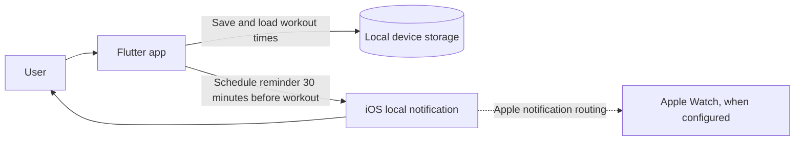

# **[Lift Off]**
One line: a personal workout-planning app for a busy student-athlete who wants help following through on gym sessions after work and class.

**Author:** [Jhonny Reyes] · **Course:** CMP 464/343 Product 1 · **Last updated:** [11/2/26]

## **1. About Me (the User)**
*Who am I in the context of this problem? What roles am I playing (student, employee, parent, athlete, gamer…)?*

[Athlete balancing full-time work and school]

**The last 3 times this happened:** *Real, recent moments. For each: when and where, what went wrong, what it cost, what you did.*

1. I want to go to the gym at least 4 times a week, but I usually only go 2 times and sometimes not at all.

2. When my gym partner can’t go, I don’t feel like going by myself, and I end up skipping.

3. I’m working and in school full time, so I choose work because it feels productive and immediate, even though I know I’m losing out on my fitness goals.

**What it costs me:** *Be specific. How often, how much?*

- ⏱️ Time: It costs me time that I intended to spend on fitness or at the gym.

- 💸 Money: It costs me money, because I am paying a gym membership that I am not putting to good use.

- 🔋 Energy: I'm stuck in a cycle where I feel guilty about skipping, so I compensate by working harder, which makes me more tired, which makes the gym feel even less appealing next time.

- 🙂 Joy: I feel disappointed in myself for not being productive in this area of my life.

## **2. Problem Statement**
**Gut check:**

I need **[to stop cancelling going to the gym]** because **[I want to be healthier and fit]**.

**Five Whys:**

1. Why? Because I'm too tired.

2. Why? Because I work and go to school full time.

3. Why? Because I do not have the time and energy.

4. Why? Because I need to be healthy and fit.

5. Why? Because I want to live a longer life, and feel better physically and mentally.

**Problem statement:**

When I’ve already worked a shift and finished class in the afternoon, I struggle to follow through with going to the gym when I’m already tired and depleted. This happens about 3 days per week, and I end up canceling instead of working out. This costs me guilt, because I feel like I’m not disciplined or consistent enough, and that makes me feel like I’m falling behind on my goals. This happens because I’m already stretched thin by work and school, and I don’t have enough time or energy left to overcome the friction of going to the gym. Right now I stay home or go back to work instead, but that feels easier in the moment and only leaves me feeling worse later because it keeps me inconsistent.

I’ll know this is solved when I go to the gym four times a week for three consecutive months, including after work and class, and feel I’m making progress toward my health goals.

*Check: none of these words appear: app, website, platform, dashboard, tool, AI, track, automate, notify, feature.*

## **3. Existing Solutions**

| **What I use or tried** | **What it does well** | **Why it falls short** ***for me*** |
| :---: | :---: | :---: |
| Gym partner/friend commitment | Accountability | Failed because schedules didn’t line up |
| Music during workouts | It helps make the experience better when already there. | Not enough to motivate going. |
|  |  |  |

**The gap:** *In one sentence, what's still missing for me?*

[No tool or workaround that reduces the decision fatigue after work + class, no structure that works when my energy is already low, and no support that preserves consistency when my schedule is inconsistent.]

## **4. Features & Benefits**
*Every feature should move me toward my "solved when" line.*

| **Feature (what it does)** | **Benefit (how my life gets better)** | **MVP or Later?** |
| :---: | :---: | :---: |
| Feature 1 — Schedule multiple workouts by date and time, with options to reschedule or delete | This makes workouts feel like planned commitments instead of spur-of-the-moment decisions, while letting me adjust when work or school changes my schedule. | MVP |
| Feature 2 — Save workout schedules on this device | My planned workout times remain available when I close and reopen the app, without requiring an account or server. | MVP |
| Feature 3 — A local reminder 30 minutes before a scheduled workout | It gives me a timely prompt to get ready and follow through. The iPhone notification can also appear on Apple Watch when Apple’s notification settings route it there. | MVP |
| Feature 4 — A system that says what days you worked out vs what days you did not (visual calendar of attendance) | This would give me a visual look at how consistent I am in the week/month. It would hold me accountable if I am slacking, and would make me feel good if I am consistent. | Later |
| Feature 5 — A system where you can log workouts and track your progression | This would give me a visual look at my progress and progression in weight, as well as motivation to keep going. | Later |
| Feature 6 — Sync and connection to health and fitness apps | This would help with tracking across applications and viewing progress, as well as sharing with friends. | Later |

## **MVP (2–3 features):** ***The skateboard: the smallest version*** ***I'd*** ***actually use.***
- Schedule multiple workout slots by date and time; view, reschedule, and delete them.

- Keep scheduled workouts saved on this device.

- Send a local notification 30 minutes before a scheduled workout.

## **Later:**
- A visual calendar of workout attendance.

- Logging workouts and tracking progression.

- Syncing or connecting with health and fitness apps.

## **Not doing:** ***Things I'm deliberately leaving out.***
- User accounts, cloud storage, and cross-device sync.

- A custom server or API.

- A web deployment for this MVP.

## **5. Tech Stack**
### **Front end**
- **Surface:** Mobile (iPhone); a macOS build is also used for development and demonstration.

- **Tools:** Flutter and Dart.

- **Why:** *How does this fit where and when I have the problem?*

  - My failure point isn’t “I forgot to plan” in general sense. It’s that after work + class, when I’m depleted, I need a prompt that cuts through the friction.

  - A mobile app lets me schedule workouts and deliver a reminder at the moment I’m most likely to bail.

  - Flutter lets me build the interface and app behavior in one codebase. The iPhone is the intended surface for an in-the-moment reminder.

### **Back end**

This MVP has no remote backend or server. Workout schedules are stored locally on the device.

| **Piece** | **Choice** | **Why** |
| :---: | :---: | :---: |
| Server / API | None | A personal scheduling MVP does not need a remote service. |
| Data storage | `shared_preferences` local storage | Saves workout date/time values on the device so they remain after the app closes. |
| Outside services (optional) | `flutter_local_notifications`, `timezone`, and `flutter_timezone` | Schedules local reminders in the device’s time zone. No push-notification server is needed. |
| Hosting / deploy | None for MVP | The app runs locally on Mac and iPhone for development and demonstration. |

### **Architecture sketch**

## **6. Open Questions**
*What am I still unsure about? What do I need to figure out or test first?*

- Can I reliably receive the iPhone’s scheduled notification on my Apple Watch in the way I expect? I tested this on my paired Watch; delivery depends on Apple’s notification settings and device state.

- What Flutter notification package and iOS permissions will I use to schedule local notifications? For this version, I use `flutter_local_notifications` and request notification permission when scheduling.

- Do I need Firestore in the first version, or would local storage be enough for the planned workout times? Local storage is enough for this personal MVP; syncing would require revisiting this choice.

- If I use Firestore, what is the simplest appropriate way to secure my personal data? Firestore is not used in this MVP.

## **Demo**

The app has been run on macOS and iPhone. The local reminder flow has been tested on iPhone, and Apple Watch delivery has been verified with the paired devices.

1. Open Lift Off and choose **Schedule a workout**.
2. Select a future date and time; show that the workout appears in the list.
3. Use a workout’s actions menu to reschedule or delete it.
4. Close and reopen the app to show the schedule remains saved.
5. For a live reminder demonstration, schedule a workout in advance so its 30-minute reminder arrives during the presentation.

**Demo screenshot:** Add a current screenshot of the workout list to the repository, then embed it here. For example: ``.
